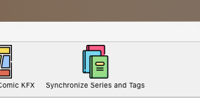

# Kindle Library Sync

This project is a Calibre plugin designed to synchronize **Series** and **Tags** (formerly known as Collections) between
your Calibre library and your Kindle device.

It is designed for modern Kindle firmware versions **5.20.2 and later**.

For older Kindle firmware versions, you can use the
original [Kindle Series Manager](https://github.com/mlapaglia/kindle-series-manager) project.

## Requirements

- [Calibre](https://calibre-ebook.com/es/download)
- A jailbroken Kindle device.
- SSH access to your Kindle. You will need to know your Kindle's IP address and SSH port.

  You can find instructions for enabling SSH access through KOReader in
  the [KOReader SSH documentation](https://github.com/koreader/koreader/wiki/SSH).

## Installation

1. Download `synchronize_series_and_tags.zip` from the project's releases.
2. Open Calibre and navigate to **Preferences > Advanced > Plugins**.
3. Click **Load plugin from file**.
4. Select the downloaded `.zip` files (install both plugins).
5. Restart Calibre to complete the installation.

## Add to Toolbar

To make the plugins accessible from the Calibre toolbar:

1. Navigate to **Preferences > Toolbars & menus**.
2. Select **The main toolbar** from the left-hand selection menu.
3. Find the **Synchronize Series** and **Synchronize Tags** actions in the available actions list.
4. Move both actions to the right-hand column.
5. Arrange them in your preferred order and click **Apply**.

## How to Use

1. Click **Synchronize Series and Tags** in the Calibre toolbar.

   

2. A configuration window will open, allowing you to configure the synchronization process.
3. Provide the required Kindle connection settings and select the synchronization options.
4. Run the synchronization.

### Important: Kindle Library Restart

The configuration window includes an option called **Restart Kindle Library after synchronization**.

This option restarts the Kindle Library service to apply the synchronization changes.

**Do not request a library restart after every synchronization operation.**

If you intend to synchronize both Series and Tags, perform both synchronization operations first and enable the restart
option only for the last operation.

This avoids unnecessary consecutive restarts of the Kindle Library.

A dialog displaying an error may appear on the Kindle during this process. This is expected behavior and does not
necessarily indicate that synchronization has failed.

## The Result

The plugins compare the Series and/or Tags defined in your Calibre library against the books available on your Kindle.

Based on this comparison, they generate and execute a synchronization plan that can:

- **Create** new Series or Tags on the Kindle.
- **Update** existing Series or Tags.
- **Preserve** existing Series or Tags that are not present in Calibre.
- **Synchronize** the resulting metadata and relationships between both environments without deleting Kindle-side data.

**Synchronization is non-destructive:** the plugins never remove existing Series or Tags from the Kindle. This preserves
the independence of your Calibre library and Kindle metadata.

The goal is to keep your Kindle library organized according to the metadata maintained in Calibre, without manually
editing the Kindle database.

## Compatibility

| Component       | Requirement       |
|-----------------|-------------------|
| Calibre         | Required          |
| Kindle          | Jailbroken device |
| Kindle firmware | 5.20.2 or later   |
| Connection      | SSH access        |

For older firmware versions, consider using [Kindle Series Manager](https://github.com/mlapaglia/kindle-series-manager).

## License

See the repository for license information.